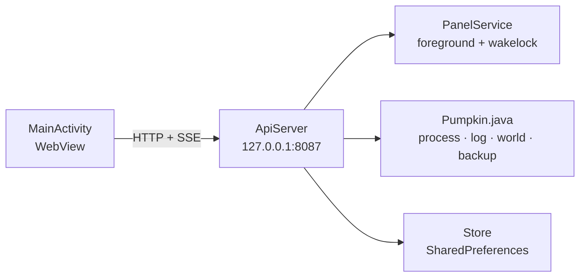

<div align="center">
  
  <h1>Pumpkin Panel for Android</h1>
  <p><b>Unofficial</b> control panel for the <a href="https://github.com/Pumpkin-MC/Pumpkin">Pumpkin</a> Minecraft server.<br>
  Runs entirely on the phone: no Termux, no proot, no Node.js, no root.</p>
</div>

<p align="center">
  <a href="https://github.com/Viralina/pumpkin-server-android/actions/workflows/build.yml"></a>
  
  
  <a href="LICENSE"></a>
</p>

> **Disclaimer** — This is a community project. It is **not** affiliated with, endorsed by, or
> sponsored by Pumpkin-MC or Mojang Studios. Pumpkin is a GPLv3 project; its binary is **not**
> bundled in this repository and is downloaded or imported by the user at runtime. Please report
> panel/APK bugs here, not in the Pumpkin repository.

## Table of contents

- [About](#about)
- [Features](#features)
- [Requirements](#requirements)
- [Installation](#installation)
- [Build](#build)
- [Repository layout](#repository-layout)
- [Modular panel](#modular-panel)
- [Data and configuration](#data-and-configuration)
- [Security](#security)
- [Local API](#local-api)
- [Troubleshooting](#troubleshooting)
- [License and attribution](#license-and-attribution)
- [Contributing](#contributing)

## About

A vanilla web panel (HTML/CSS/JS) runs in a WebView and is served by a small HTTP + SSE server
written in Java. The whole UI is bundled inside the APK, so the panel keeps working offline and
never reads HTML from `/sdcard`.



It is meant for running a Pumpkin server straight from a phone: download the binary once, edit
`pumpkin.toml`, then manage the server from the same panel.

## Features

| Group | Contents |
| --- | --- |
| Server | Start, stop, restart, kill; real-time status over SSE |
| Console | Live log, level filter, send commands, command history |
| Configuration | `pumpkin.toml` editor by group, world seed, switch active world |
| World | Use, rename, regenerate with a seed, delete |
| Players | Online list, OP/deop, whitelist, kick, ban/unban, gamemode |
| Backup | Create `.tar.gz` of the world folder, list, delete (hidden menu) |
| Network | Online panel toggle, 3-mode panel bind, separate Pumpkin bind |
| Appearance | ID/EN language, dark/light theme, green accent, guide popups |
| Security | Private token for the HTML page and every `/api/*` route |

Features that are not obvious in the UI — the hidden backup menu, binary swap, and the
`panel.log` diagnostics — are explained in [`docs/NOTES.md`](docs/NOTES.md).

## Requirements

- **Android 7.0+** (minSdk 24), **arm64**.
- **Pumpkin `0.2.2+26.3-26.60`** — two APK variants are available:
  - **full** — the official binary is already bundled in the APK; install and use it without
    an internet connection.
  - **plain** — no binary. On first use press **Download Pumpkin** (±120 MB, needs internet),
    or import an existing `pumpkin-aarch64-android` (SAF or `/sdcard`).
  The binary is never part of the repository; it only goes into the full APK built locally.
- Storage permission. The APK uses `targetSdk 28` so the ELF binary may be executed from the
  app data folder and `/sdcard` stays accessible through legacy storage permissions.

The panel is tested with Pumpkin `0.2.2+26.3-26.60`. Pumpkin is under active development, so
option names in `pumpkin.toml` may change between releases.

## Installation

1. Build the APK (see [Build](#build)) or download the **plain** artifact from the **Actions** tab.
2. Install the APK, open **Pumpkin Panel**, and grant storage access.
3. **Full variant:** the binary is already there, skip to step 5. **Plain variant:** press
   **Download Pumpkin 0.2.2**, **Import from file**, or place the binary at `/sdcard/pumpkin`
   and press **Import from /sdcard/pumpkin**.
4. The panel opens automatically once the binary is ready.
5. Edit `pumpkin.toml` (world, seed, port, MOTD), then press **Start server**.

Default ports: panel `8087`, Java `25565`, Bedrock `19132` (UDP). Stop any old panel/Pumpkin
instance using those ports before testing this APK.

<details>
<summary><b>Migrating from a Termux/proot install</b></summary>

Copy the old server data to `/sdcard/server`, **without** its Linux binary:

```bash
mkdir -p /sdcard/server
cp -a ~/debian-fs/root/server/pumpkin-server/pumpkin.toml /sdcard/server/
cp -a ~/debian-fs/root/server/pumpkin-server/world        /sdcard/server/
cp -a ~/debian-fs/root/server/pumpkin-server/data         /sdcard/server/
cp -a ~/debian-fs/root/server/pumpkin-server/logs         /sdcard/server/ 2>/dev/null
cp -a ~/debian-fs/root/server/pumpkin-server/plugins      /sdcard/server/ 2>/dev/null
cp -a ~/debian-fs/root/server/pumpkin-server/nethernet-key.der /sdcard/server/ 2>/dev/null

# Do not copy "pumpkin" from that folder: it is a Linux/glibc build and cannot
# run on Android. Use the Download / Import buttons in the app instead.
```

</details>

<details>
<summary><b>Android binary vs Linux/glibc</b></summary>

Only `pumpkin-aarch64-android` works on Android (an ELF with the interpreter
`/system/bin/linker64`). The `pumpkin-aarch64-unknown-linux-gnu` build uses
`/lib/ld-linux-aarch64.so.1` and fails with `Exec format error`.

The app checks `PT_INTERP` before importing and before starting. glibc builds are rejected with
a clear message; an old binary that turns out to be glibc brings the setup screen back.

Locations scanned by the import button:

```
/sdcard/pumpkin
/sdcard/Download/pumpkin
/sdcard/Download/pumpkin-aarch64-android
/sdcard/server/pumpkin
```

</details>

## Build

### Command line (no Gradle)

You need JDK 17 (`javac`, `keytool`), Android SDK Build-Tools 34.0.0 (`aapt2`, `d8`,
`apksigner`), `zip`, and `android.jar` from platform 34. Put the build-tools folder on `PATH`,
or set `ANDROID_JAR` if your SDK lives elsewhere.

```bash
# android.jar (once only)
mkdir -p ~/android-build && cd ~/android-build
curl -LO https://dl.google.com/android/repository/platform-34-ext7_r03.zip
unzip -o platform-34-ext7_r03.zip android-34/android.jar -d sdk

cd pumpkin-server-android

# 1) Plain APK (no binary)
./build.sh
# output: build/apk/pumpkin-panel-plain.apk

# 2) Full APK (official binary bundled)
./build.sh --with-binary /sdcard/pumpkin-aarch64-android
# output: build/apk/pumpkin-panel-full.apk
```

`build.sh` runs: bundle the panel → `aapt2 compile` → `aapt2 link` → `javac` → `d8` →
`zip` (classes.dex) → `apksigner`. The debug keystore is generated automatically and is not
committed. The binary is only copied into a staging folder under `build/`, never into
`app/src/main/assets` or the git history.

| Variant | Contents | Size | When to use |
| --- | --- | --- | --- |
| `pumpkin-panel-plain.apk` | panel only | ±180 KB | binary already present / download it yourself |
| `pumpkin-panel-full.apk` | panel + `pumpkin-aarch64-android` | ±33 MB (120 MB binary inside) | install and go, no download |

Both use the same package (`com.pumpkin.panel`), so they replace each other on install; data in
`/sdcard/server` and the extracted binary are kept. The full variant extracts the binary once on
first launch (needs about 120 MB free in app storage), including replacing an older binary that
is already there. After that the binary is not overwritten again — including when you import a
different binary through the import menu.

### GitHub Actions

The [`build.yml`](.github/workflows/build.yml) workflow runs the same `build.sh` on an Ubuntu
runner (JDK 17 + Android SDK 34 + build-tools 34.0.0). Open
**Actions → Build APK → Run workflow**, then download the `pumpkin-panel-plain` artifact.

CI builds the plain variant only because the Pumpkin binary is not stored in the repository. For
the full variant, run the `--with-binary` command above on a machine that has the binary.

APKs from Actions are signed with the runner's debug keystore, so the key differs from a local
APK. Uninstall first when switching APK sources; data in `/sdcard/server` is not deleted.

### Gradle

```bash
bash tools/bundle-panel.sh   # bundled asset is not committed
gradle assembleDebug
# output: app/build/outputs/apk/debug/app-debug.apk
```

The app version lives in `build.sh` and `app/build.gradle.kts` — change both together.

## Repository layout

```
app/                    Android app (plain Java, no external dependencies)
  src/main/java/...     WebView, service, API, Pumpkin process, TOML, tar.gz
  src/main/res/         icons, theme, strings
panel/                  modular web panel source
  index.html            template with <link> and <script src>
  css/                  5 files
  js/                   16 files
tools/bundle-panel.sh   merges the panel into one index.html for the APK
docs/PANEL.md           panel structure and file ordering rules
docs/NOTES.md           developer notes, hidden features, security
docs/assets/banner.svg  original banner for this project (Apache-2.0)
build.sh                build plain/full APK without Gradle
NOTICE                  third-party attribution and disclaimer
```

## Modular panel

The panel source is split up for readability, but **the APK still contains a single HTML file**.
`build.sh` calls `tools/bundle-panel.sh` and writes the result to the staging folder
`build/assets/`, then packs it into the APK. The bundled asset is not committed.

```bash
bash tools/bundle-panel.sh                       # -> app/src/main/assets/index.html
bash tools/bundle-panel.sh /tmp/preview.html     # output for inspection
```

The runtime never reads the panel from `/sdcard`. Details on the structure, load order, and how
to add a module are in [`docs/PANEL.md`](docs/PANEL.md).

## Data and configuration

| Item | Path |
| --- | --- |
| Pumpkin binary | `/data/data/com.pumpkin.panel/files/pumpkin` |
| Server data (world, config, logs) | `/sdcard/server` |
| `pumpkin.toml` | `/sdcard/server/pumpkin.toml` |
| Panel UI (embedded in the APK) | `app/src/main/assets/index.html` |
| Backups | `/sdcard/server/backups` |
| Start/stop diagnostics | `/sdcard/server/panel.log` |

The two bind addresses are deliberately separate:

| Purpose | Stored in | Default |
| --- | --- | --- |
| Web panel (another phone opens the panel) | SharedPreferences `host` + `panelOnline` | `127.0.0.1`, online **off** |
| Pumpkin server (players connect) | `pumpkin.toml` → `networking.java.address` and `networking.bedrock.nethernet.address` | `0.0.0.0` |

When the online panel is off, the panel server is forced to bind to loopback. Restart the
Pumpkin server after changing its bind address.

## Security

- A random 16-byte token is generated automatically the first time the app runs.
- **Every** request — HTML and `/api/*`, localhost or LAN — must include the token:
  `?token=...` for pages, the `x-token` header for the API.
- Without a matching token the server does not send the panel HTML; only the lock page appears.
- Binding to `0.0.0.0` without a token is still forced to `127.0.0.1`.
- The WebView blocks every non-local `http`/`https` request.
- The token is stored in the device's SharedPreferences. Never commit a token or keystore.

The threat model and implementation details are in [`docs/NOTES.md`](docs/NOTES.md).

## Local API

Every route uses the token. The contract matches the old panel:

| Group | Routes |
| --- | --- |
| Status | `/api/ping`, `/api/status`, `/api/logs`, `/api/stream` |
| Control | `/api/start`, `/api/stop`, `/api/kill`, `/api/restart`, `/api/command` |
| Configuration | `/api/config` |
| Players | `/api/players*` |
| World | `/api/worlds*` |
| Backup | `/api/backups`, `/api/backup` |
| Settings | `/api/settings`, `/api/net` |

Example from the same device:

```bash
curl -H "x-token: $TOKEN" http://127.0.0.1:8087/api/status
```

## Troubleshooting

<details>
<summary><b>“Panel API is not responding”</b></summary>

The service failed to open the port. Check whether `8087` is used by another process (e.g. a
Termux panel), then reopen the app.
</details>

<details>
<summary><b>The server exits immediately</b></summary>

Check the console. Common causes: a broken `pumpkin.toml`, an unwritable world, or a binary that
is not arm64. Look in `/sdcard/server/panel.log` for the `EXIT` / `EXEC GAGAL` lines and the
`interp=` value (ELF interpreter).
</details>

<details>
<summary><b>Pumpkin is killed by the system</b></summary>

Allow the app to run in the background and disable battery optimization. The service holds a
foreground notification + wakelock while the server is running.
</details>

<details>
<summary><b>Opening the panel from another phone/browser</b></summary>

Copy the token from **Settings → Panel access token**, then open
`http://IP:8087/?token=TOKEN`. Without the token, only the lock page appears.
</details>

<details>
<summary><b>Going back to /sdcard after using the app folder</b></summary>

Change the server folder path in Settings. Data in the app folder is not deleted automatically.
</details>

## License and attribution

The code in this repository is licensed under **Apache-2.0** — see [`LICENSE`](LICENSE) and
[`NOTICE`](NOTICE).

- **Pumpkin** — [Pumpkin-MC/Pumpkin](https://github.com/Pumpkin-MC/Pumpkin), GPLv3. No Pumpkin
  source code is included in this repository. The **plain** APK downloads/imports the official
  binary at runtime; the **full** APK built locally includes the official binary unmodified.
  That binary remains under GPLv3, not this repository's license, and is not committed. If you
  distribute a full APK, comply with GPLv3 (include the Pumpkin source or a link to it).
- **Minecraft** — trademark of Mojang Studios / Microsoft. This project is not affiliated.
  The button click sound comes from Minecraft and is not covered by this repository's license.
- **Banner** — [`docs/assets/banner.svg`](docs/assets/banner.svg) is original artwork for this
  project (Apache-2.0), not the official Pumpkin logo. The Pumpkin name and logo belong to
  Pumpkin-MC.

## Contributing

Issues and pull requests are welcome. Before sending a PR:

1. Edit the source in `panel/`, not `app/src/main/assets/index.html` (the bundled output).
2. Do not add external/CDN assets — the panel must stay offline and a single file.
3. Run `bash tools/bundle-panel.sh` and make sure the panel still works.
4. Do not commit tokens, keystores, or personal paths.
