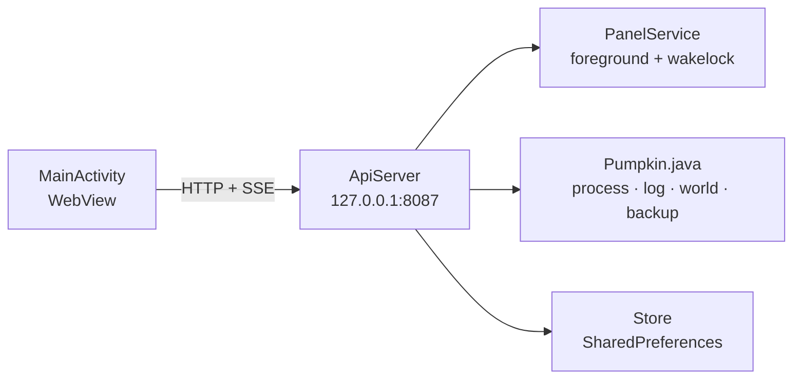

<div align="center">
  
  <h1>Pumpkin Panel for Android</h1>
  <p><b>Unofficial</b> control panel for the <a href="https://github.com/Pumpkin-MC/Pumpkin">Pumpkin</a> Minecraft server.<br>
  Runs entirely on the phone: no Termux, no proot, no Node.js, no root.</p>
</div>

<p align="center">
  <a href="https://github.com/Viralina/pumpkin-server-android/actions/workflows/build.yml"></a>
  
  
  <a href="LICENSE"></a>
</p>

> **Disclaimer** — This is a community project. It is **not** affiliated with, endorsed by, or
> sponsored by Pumpkin-MC or Mojang Studios. Pumpkin is a GPLv3 project; its binary is **not**
> bundled in this repository and is downloaded or imported by the user at runtime. Please report
> panel/APK bugs here, not in the Pumpkin repository.

## Daftar isi

- [Tentang](#tentang)
- [Fitur](#fitur)
- [Kebutuhan](#kebutuhan)
- [Instalasi](#instalasi)
- [Build](#build)
- [Struktur repo](#struktur-repo)
- [Panel modular](#panel-modular)
- [Data dan konfigurasi](#data-dan-konfigurasi)
- [Keamanan](#keamanan)
- [API lokal](#api-lokal)
- [Troubleshooting](#troubleshooting)
- [Lisensi dan atribusi](#lisensi-dan-atribusi)
- [Kontribusi](#kontribusi)

## Tentang

Panel web vanilla (HTML/CSS/JS) dijalankan di WebView dan dilayani oleh HTTP + SSE server
kecil yang ditulis dalam Java. Seluruh UI dibundel di dalam APK, jadi panel tetap berjalan
offline dan tidak pernah membaca HTML dari `/sdcard`.



Cocok untuk menjalankan server Pumpkin langsung dari HP: unduh binary sekali, atur
`pumpkin.toml`, lalu kelola server dari panel yang sama.

## Fitur

| Kelompok | Isi |
| --- | --- |
| Server | Start, stop, restart, kill; status real-time lewat SSE |
| Console | Log langsung, filter level, kirim perintah, riwayat perintah |
| Konfigurasi | Editor `pumpkin.toml` per grup, seed world, ganti world aktif |
| World | Pakai, ganti nama, regenerate dengan seed, hapus |
| Pemain | Online, OP/deop, whitelist, kick, ban/unban, gamemode |
| Backup | Buat `.tar.gz` dari folder world, daftar, hapus (menu rahasia) |
| Jaringan | Sakelar panel online, bind panel 3 mode, bind Pumpkin terpisah |
| Tampilan | Bahasa ID/EN, tema gelap/terang, aksen hijau, popup panduan |
| Keamanan | Token privat untuk halaman HTML dan seluruh `/api/*` |

Fitur yang tidak menonjol di UI — menu backup rahasia, tukar binary, diagnostik `panel.log` —
dijelaskan di [`docs/NOTES.md`](docs/NOTES.md).

## Kebutuhan

- **Android 7.0+** (minSdk 24), **arm64**.
- **Pumpkin `0.2.2+26.3-26.60`** — tersedia dua varian APK:
  - **full** — binary resmi sudah dibundel di APK; setelah dipasang langsung bisa dipakai tanpa internet.
  - **polosan** — tanpa binary. Pada pemakaian pertama tekan **Unduh Pumpkin** (±120 MB, butuh
    internet), atau impor `pumpkin-aarch64-android` yang sudah dimiliki (SAF atau `/sdcard`).
  Binary tidak pernah masuk ke repo; hanya ke APK full yang dibuild lokal.
- Izin penyimpanan. APK memakai `targetSdk 28` agar binary ELF boleh dieksekusi dari folder
  data aplikasi dan `/sdcard` dapat diakses dengan izin legacy.

Panel diuji dengan Pumpkin `0.2.2+26.3-26.60`. Pumpkin masih dalam pengembangan aktif, jadi
nama opsi di `pumpkin.toml` bisa berubah antar rilis.

## Instalasi

1. Build APK (lihat [Build](#build)) atau ambil artifact **polosan** dari tab **Actions**.
2. Pasang APK, buka **Pumpkin Panel**, lalu izinkan akses penyimpanan.
3. **Varian full:** binary sudah ada, langsung lanjut ke langkah 5. **Varian polosan:** tekan
   **Unduh Pumpkin 0.2.2**, **Impor dari file**, atau taruh binary di `/sdcard/pumpkin` lalu
   tekan **Impor dari /sdcard/pumpkin**.
4. Panel terbuka otomatis setelah binary siap.
5. Atur `pumpkin.toml` (world, seed, port, MOTD), lalu **Mulai server**.

Port default: panel `8087`, Java `25565`, Bedrock `19132` (UDP). Hentikan panel/Pumpkin lama
yang memakai port tersebut sebelum menguji APK ini.

<details>
<summary><b>Pindahan dari instalasi Termux/proot</b></summary>

Salin data server lama ke `/sdcard/server`, **tanpa** binary Linux-nya:

```bash
mkdir -p /sdcard/server
cp -a ~/debian-fs/root/server/pumpkin-server/pumpkin.toml /sdcard/server/
cp -a ~/debian-fs/root/server/pumpkin-server/world        /sdcard/server/
cp -a ~/debian-fs/root/server/pumpkin-server/data         /sdcard/server/
cp -a ~/debian-fs/root/server/pumpkin-server/logs         /sdcard/server/ 2>/dev/null
cp -a ~/debian-fs/root/server/pumpkin-server/plugins      /sdcard/server/ 2>/dev/null
cp -a ~/debian-fs/root/server/pumpkin-server/nethernet-key.der /sdcard/server/ 2>/dev/null

# Jangan salin pumpkin dari folder itu: itu build Linux/glibc dan tidak bisa
# dieksekusi di Android. Gunakan tombol Unduh / Impor di aplikasi.
```

</details>

<details>
<summary><b>Binary Android vs Linux/glibc</b></summary>

Yang bisa dipakai di Android hanya `pumpkin-aarch64-android` (ELF dengan interpreter
`/system/bin/linker64`). Build `pumpkin-aarch64-unknown-linux-gnu` memakai
`/lib/ld-linux-aarch64.so.1` dan gagal dengan `Exec format error`.

Aplikasi memeriksa `PT_INTERP` sebelum impor dan sebelum start. Build glibc ditolak dengan
pesan jelas; binary lama yang ternyata glibc memunculkan layar pemasangan lagi.

Sumber yang dipindai tombol impor:

```
/sdcard/pumpkin
/sdcard/Download/pumpkin
/sdcard/Download/pumpkin-aarch64-android
/sdcard/server/pumpkin
```

</details>

## Build

### Termux (tanpa Gradle)

Termux menyediakan `aapt2`, `d8`, dan `apksigner` untuk arm64:

```bash
pkg install aapt2 d8 apksigner openjdk-17 zip

# android.jar (sekali saja)
mkdir -p ~/android-build && cd ~/android-build
curl -LO https://dl.google.com/android/repository/platform-34-ext7_r03.zip
unzip -o platform-34-ext7_r03.zip android-34/android.jar -d sdk

cd pumpkin-server-android

# 1) APK polosan (tanpa binary)
./build.sh
# hasil: build/apk/pumpkin-panel-plain.apk

# 2) APK full (binary resmi ikut dibundel)
./build.sh --with-binary /sdcard/pumpkin-aarch64-android
# hasil: build/apk/pumpkin-panel-full.apk
```

`build.sh` menjalankan: bundel panel → `aapt2 compile` → `aapt2 link` → `javac` → `d8` →
`zip` (classes.dex) → `apksigner`. Keystore debug dibuat otomatis dan tidak ikut ke repo.
Binary hanya disalin ke folder staging di `build/`, tidak pernah ke `app/src/main/assets`
atau riwayat git.

| Varian | Isi | Ukuran | Kapan dipakai |
| --- | --- | --- | --- |
| `pumpkin-panel-plain.apk` | panel saja | ±180 KB | binary sudah ada / ingin unduh sendiri |
| `pumpkin-panel-full.apk` | panel + `pumpkin-aarch64-android` | ±33 MB (binary 120 MB di dalamnya) | pasang langsung, tanpa unduh |

Keduanya memakai package yang sama (`com.pumpkin.panel`), jadi saling menimpa saat dipasang;
data di `/sdcard/server` dan binary hasil ekstraksi tetap aman. Varian full mengekstrak binary
sekali saat pertama dibuka (butuh ruang kosong ±120 MB di penyimpanan aplikasi), termasuk
mengganti binary lama yang sudah ada. Setelah itu binary tidak ditimpa lagi — termasuk jika
kamu mengimpor binary lain lewat menu impor.

### GitHub Actions

Workflow [`.github/workflows/build.yml`](.github/workflows/build.yml) menjalankan `build.sh`
yang sama di runner Ubuntu (JDK 17 + Android SDK 34 + build-tools 34.0.0). Buka
**Actions → Build APK → Run workflow**, lalu unduh artifact `pumpkin-panel-plain`.

CI hanya membangun varian polosan karena binary Pumpkin tidak disimpan di repo. Untuk varian
full, jalankan perintah `--with-binary` di atas pada mesin yang memiliki binary tersebut.

APK dari Actions ditandatangani dengan debug keystore milik runner, jadi kuncinya berbeda dari
APK lokal. Uninstal dulu saat berpindah sumber APK; data di `/sdcard/server` tidak terhapus.

### Gradle

```bash
bash tools/bundle-panel.sh   # aset hasil bundling tidak di-commit
gradle assembleDebug
# hasil: app/build/outputs/apk/debug/app-debug.apk
```

Versi aplikasi ada di `build.sh` dan `app/build.gradle.kts` — ubah keduanya bersamaan.

## Struktur repo

```
app/                    aplikasi Android (Java murni, tanpa dependency eksternal)
  src/main/java/...     WebView, service, API, proses Pumpkin, TOML, tar.gz
  src/main/res/         ikon, tema, string
panel/                  sumber panel web modular
  index.html            template dengan <link> dan <script src>
  css/                  5 berkas
  js/                   16 berkas
tools/bundle-panel.sh   penggabung panel -> satu index.html untuk APK
docs/PANEL.md           struktur panel dan aturan urutan berkas
docs/NOTES.md           catatan pengembang, fitur tersembunyi, keamanan
docs/assets/banner.svg  banner asli proyek ini (Apache-2.0)
build.sh                build APK plain/full tanpa Gradle
NOTICE                  atribusi pihak ketiga dan disclaimer
```

## Panel modular

Sumber panel dipecah agar mudah dibaca, tetapi **APK tetap berisi satu file HTML**. `build.sh`
memanggil `tools/bundle-panel.sh` dan menulis hasilnya ke folder staging `build/assets/`, lalu
mengemasnya ke APK. Aset hasil bundling tidak di-commit.

```bash
bash tools/bundle-panel.sh                       # -> app/src/main/assets/index.html
bash tools/bundle-panel.sh /tmp/preview.html     # hasil untuk diperiksa
```

Runtime tidak pernah membaca panel dari `/sdcard`. Detail struktur, urutan loading, dan cara
menambah modul ada di [`docs/PANEL.md`](docs/PANEL.md).

## Data dan konfigurasi

| Isi | Path |
| --- | --- |
| Binary Pumpkin | `/data/data/com.pumpkin.panel/files/pumpkin` |
| Data server (world, config, log) | `/sdcard/server` |
| `pumpkin.toml` | `/sdcard/server/pumpkin.toml` |
| UI panel (tertanam di APK) | `app/src/main/assets/index.html` |
| Backup | `/sdcard/server/backups` |
| Diagnostik start/stop | `/sdcard/server/panel.log` |

Dua alamat bind sengaja dipisah:

| Kebutuhan | Disimpan di | Default |
| --- | --- | --- |
| Panel web (HP lain membuka panel) | SharedPreferences `host` + `panelOnline` | `127.0.0.1`, online **mati** |
| Server Pumpkin (pemain masuk) | `pumpkin.toml` → `networking.java.address` dan `networking.bedrock.nethernet.address` | `0.0.0.0` |

Saat panel online mati, server panel dipaksa bind ke loopback. Restart server Pumpkin setelah
mengubah alamat bind-nya.

## Keamanan

- Token 16 byte acak dibuat otomatis saat pertama kali aplikasi berjalan.
- **Semua** akses — HTML maupun `/api/*`, localhost atau LAN — wajib menyertakan token:
  `?token=...` untuk halaman, header `x-token` untuk API.
- Tanpa token yang cocok, server tidak mengirim HTML panel; yang tampil hanya halaman kunci.
- Bind ke `0.0.0.0` tanpa token tetap dipaksa ke `127.0.0.1`.
- WebView memblokir semua request `http`/`https` non-lokal.
- Token disimpan di SharedPreferences perangkat. Jangan commit token atau keystore.

Model ancaman dan detail implementasi ada di [`docs/NOTES.md`](docs/NOTES.md).

## API lokal

Semua route memakai token. Kontraknya sama dengan panel lama:

| Kelompok | Route |
| --- | --- |
| Status | `/api/ping`, `/api/status`, `/api/logs`, `/api/stream` |
| Kontrol | `/api/start`, `/api/stop`, `/api/kill`, `/api/restart`, `/api/command` |
| Konfigurasi | `/api/config` |
| Pemain | `/api/players*` |
| World | `/api/worlds*` |
| Backup | `/api/backups`, `/api/backup` |
| Pengaturan | `/api/settings`, `/api/net` |

Contoh dari perangkat yang sama:

```bash
curl -H "x-token: $TOKEN" http://127.0.0.1:8087/api/status
```

## Troubleshooting

<details>
<summary><b>“Panel API tidak merespons”</b></summary>

Service gagal membuka port. Periksa apakah `8087` dipakai proses lain (mis. panel Termux),
lalu buka ulang aplikasi.
</details>

<details>
<summary><b>Server langsung mati</b></summary>

Lihat console. Penyebab umum: `pumpkin.toml` rusak, world tidak bisa ditulis, atau binary
bukan arm64. Cek `/sdcard/server/panel.log` untuk baris `EXIT` / `EXEC GAGAL` beserta
`interp=` (interpreter ELF).
</details>

<details>
<summary><b>Pumpkin dimatikan sistem</b></summary>

Izinkan aplikasi berjalan di latar belakang dan matikan optimasi baterai. Service memakai
foreground notification + wakelock selama server hidup.
</details>

<details>
<summary><b>Panel dibuka dari HP/browser lain</b></summary>

Salin token dari **Pengaturan → Token akses panel**, lalu buka
`http://IP:8087/?token=TOKEN`. Tanpa token, yang tampil hanya halaman kunci.
</details>

<details>
<summary><b>Ingin kembali ke /sdcard setelah memakai folder app</b></summary>

Ubah path folder server di Pengaturan. Data di folder app tidak dihapus otomatis.
</details>

## Lisensi dan atribusi

Kode di repo ini dilisensikan **Apache-2.0** — lihat [`LICENSE`](LICENSE) dan [`NOTICE`](NOTICE).

- **Pumpkin** — [Pumpkin-MC/Pumpkin](https://github.com/Pumpkin-MC/Pumpkin), GPLv3. Tidak ada
  source code Pumpkin di repo ini. APK **polosan** mengunduh/mengimpor binary resmi saat
  dijalankan; APK **full** yang dibuild lokal menyertakan binary resmi tanpa modifikasi.
  Binary tersebut tetap tunduk pada GPLv3, bukan lisensi repo ini, dan tidak di-commit.
  Jika kamu membagikan APK full, penuhi GPLv3 (sertakan sumber/tautan source Pumpkin).
- **Minecraft** — merek dagang Mojang Studios / Microsoft. Proyek ini tidak berafiliasi.
  Suara klik tombol berasal dari Minecraft dan tidak dicakup lisensi repo ini.
- **Banner** — [`docs/assets/banner.svg`](docs/assets/banner.svg) adalah karya asli untuk
  proyek ini (Apache-2.0), bukan logo resmi Pumpkin. Logo dan merek Pumpkin milik Pumpkin-MC.

## Kontribusi

Issue dan pull request terbuka. Sebelum mengirim PR:

1. Edit sumber di `panel/`, bukan `app/src/main/assets/index.html` (hasil bundling).
2. Jangan menambahkan aset eksternal/CDN — panel harus tetap offline dan satu file.
3. Jalankan `bash tools/bundle-panel.sh` dan pastikan panel masih berjalan.
4. Jangan commit token, keystore, atau path pribadi.
